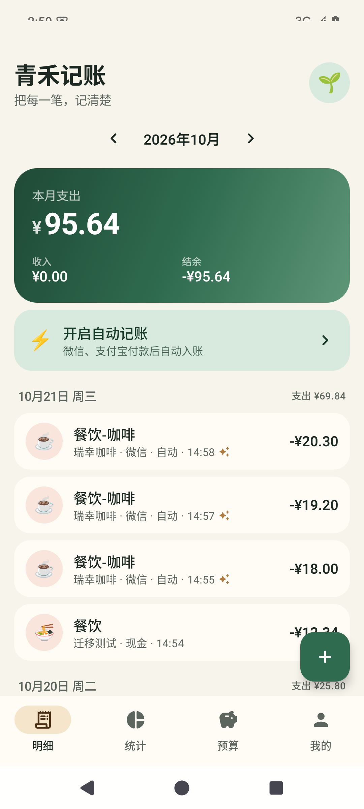
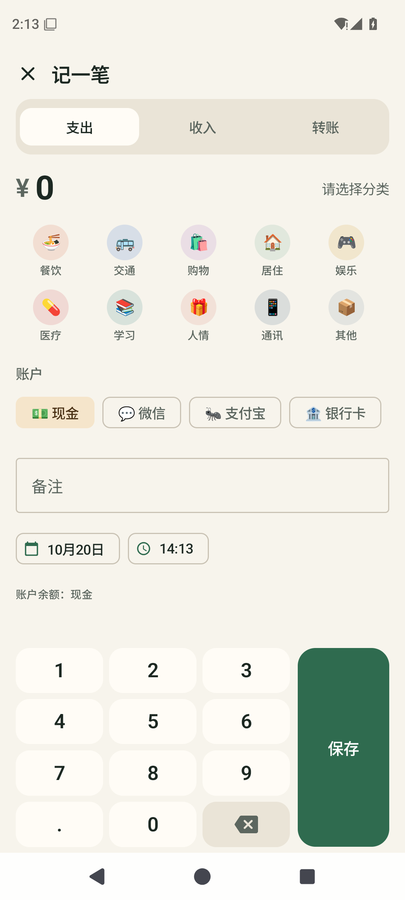
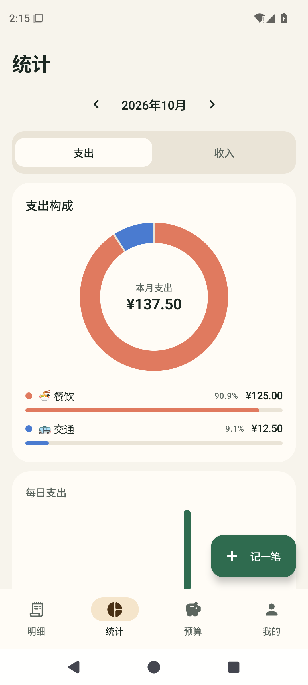
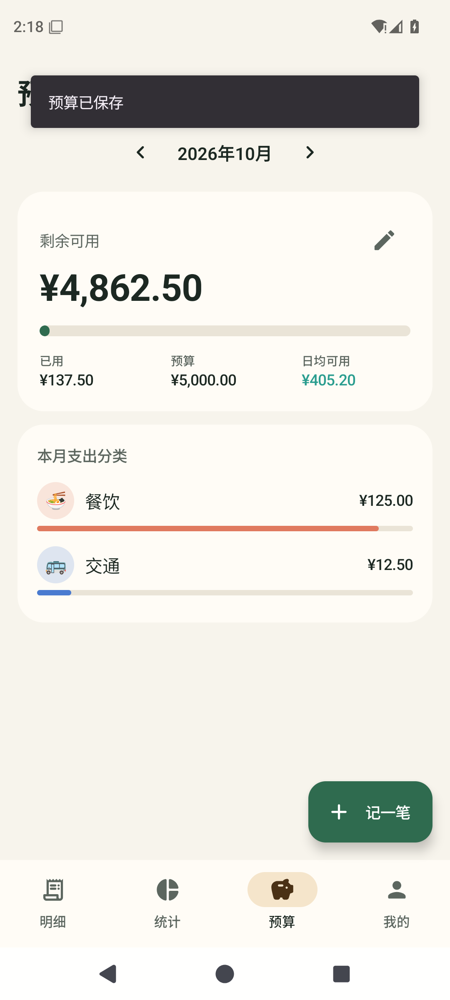
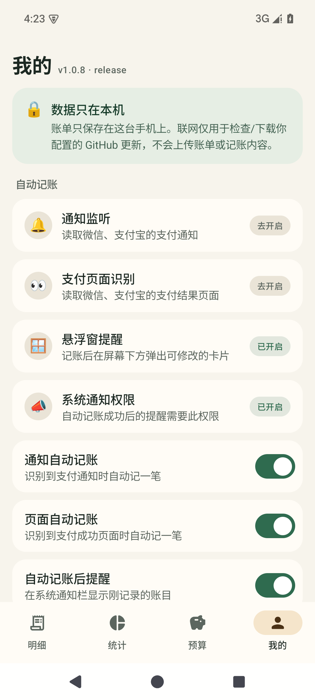
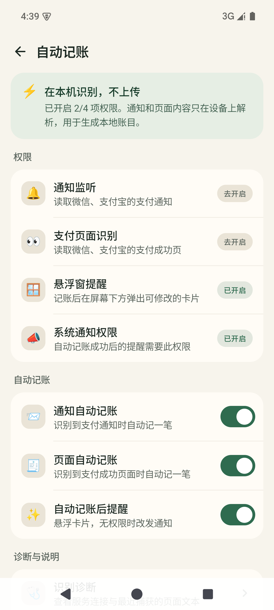

# 青禾记账

> 本地优先的 Android 自动记账应用。微信、支付宝、抖音、美团付款后自动记一笔，账目只留在你的手机上。

[](https://github.com/newbeezzc/qinghe-ledger/releases)
[](https://developer.android.com)
[](https://kotlinlang.org)

青禾记账是一个开源的个人记账 Android 应用：手动记一笔足够快，开启通知监听或无障碍服务后，微信支付 / 支付宝 / 抖音 / 美团付款可以自动入账。没有账号、没有广告、没有统计 SDK，账目保存在本机 SQLite 数据库。

## 功能

- **手动记账**：支出 / 收入 / 转账，自定义金额键盘，支持日期时间、账户和备注
- **自动记账**：
  - 通知监听：识别微信「微信支付」、支付宝、抖音、美团的支付通知
  - 页面识别：识别支付成功页或单笔账单详情页（不依赖 OCR）
  - 自动去重：通知和页面两条路径不会重复入账
  - 确认页：自动记账后在当前付款 App 上弹出一个不超过半屏的悬浮窗，金额、分类、账户、备注和支付时间已自动填好；右下角「确认」保存，右下角「取消」删除这笔自动账目并返回付款 App。没有悬浮窗权限时回退到通知栏
- **两级分类**：大类 + 小类，内置 16 个大类、50 个小类，可自定义
- **智能归类**：按用户规则、商户名、商品说明、平台关键词和支付时间自动落到小类
- **账户**：现金、微信、支付宝、抖音、美团、银行卡，余额随账目自动计算
- **统计**：支出 / 收入构成、分类占比、每日柱状图
- **预算**：月度预算、剩余额度、日均可用、分类进度
- **明细**：按月查看、按日分组、编辑、长按删除
- **更新**：优先从 Gitee Release 检查更新（国内更稳），失败时回退 GitHub；支持镜像、断点续传和签名校验

## 界面预览

| 明细 | 记一笔 | 统计 |
| --- | --- | --- |
|  |  |  |

| 预算 | 我的 | 自动记账设置 |
| --- | --- | --- |
|  |  |  |

更多截图见 [`docs/screenshots/`](docs/screenshots/)。

## 自动记账怎么工作

自动记账是可选的，需要你在系统设置中手动授权：

1. **通知监听**：读取微信「微信支付」、支付宝、抖音、美团的支付通知，提取金额、商户和通知时间。
2. **无障碍页面识别**：读取微信 / 支付宝 / 抖音 / 美团的支付成功页或单笔账单详情页。先判断页面结构（成功标题 + 强上下文，或账单详情字段），再读取金额；首页、余额 / 额度 / 收益、账单列表等普通含数字页面不会记账。使用 DFS、关键词搜索、父节点回溯和多次延迟重试，不读取聊天内容，不使用 OCR。
3. **解析与归类**：`PaymentParser`（纯 Kotlin，可单元测试）提取金额、收支方向、商户和时间；`AutoCategoryClassifier` 按「用户规则 → 商户/商品关键词 → 平台关键词 → 支付时间」选择小类。
4. **去重与落库**：通知和页面事件会经过同一把互斥锁，同时检查最近入库时间和支付时间窗口，避免重复记录。
5. **确认页**：自动记账后在付款 App 上显示半屏悬浮确认窗（分类选择与手动记账完全一致）；右下角「确认」保存，右下角「取消」删除这笔自动账目；没有悬浮窗权限时回退到高优先级通知。

权限用途：

| 权限 | 用途 |
| --- | --- |
| 通知使用权 | 读取微信 / 支付宝 / 抖音 / 美团支付通知 |
| 无障碍服务 | 读取微信 / 支付宝 / 抖音 / 美团的支付成功页或账单详情页 |
| 自动记账弹窗 | 支付后直接打开可修改 / 取消的记账页 |
| 通知权限 | 自动记账结果提醒 |
| 网络 | 优先检查 / 下载 Gitee Release 更新，失败时回退 GitHub（直连失败时经公共镜像下载 APK） |

**边界**：自动识别不保证 100% 准确。银行 App、云闪付、部分小程序支付、红包等场景可能识别不到；微信、支付宝、抖音、美团改版也可能导致页面识别失效。重要账目请偶尔核对。

## 隐私

- 账目、分类、账户、预算和规则全部保存在本机 Room 数据库。
- 不要求注册账号，不收集手机号、位置、通讯录、相册或设备标识。
- 没有广告、统计分析或第三方数据 SDK。
- `INTERNET` 权限只用于检查 / 下载 Gitee 或 GitHub Release 更新；Gitee 不可用时回退 GitHub，GitHub 直连失败时会尝试 `ghfast.top`、`gh-proxy.com`、`ghproxy.net` 等公共镜像下载 APK，请求中不包含账目、通知或页面文本。下载的 APK 安装前仍会校验包名、版本和签名。
- 关闭自动记账开关或撤销系统授权后，自动记账立即停止。

更完整的说明见 [`docs/privacy-policy.md`](docs/privacy-policy.md)。

## 下载与安装

从 [GitHub Releases](https://github.com/newbeezzc/qinghe-ledger/releases/latest) 下载最新 APK：

```
dist/qinghe-1.0.21.apk
```

也可以连接手机后安装：

```bash
adb install -r dist/qinghe-1.0.21.apk
```

安装后在「我的」标题旁可以看到 `v1.0.21 · release`（如果是 `debug`，说明装错了包）。

当前 APK 的 SHA-256：

```
40d5f3bb694430edfe29a368dd41adf1aabb4534789aba98956ea8aacc52684d
```

### 签名说明

发布 APK 目前使用开发调试证书签名，适合个人分发和自用。应用内更新会校验签名，**换签名后已安装用户无法覆盖升级**，需要卸载重装。自行构建并分发时，请配置自己的 release keystore，并备份好密钥。

### 自动更新

应用默认优先从 `newbeezzc/qinghe-ledger` 的 **Gitee Release** 检查更新（国内访问更稳定）；Gitee 不可用、没有 Release 或没有可下载的 APK 时，自动回退到 GitHub Release。更新源内置在应用中，不在「我的」页面显示。更新器会校验包名、更高的 versionCode、非 debug 构建和证书一致性。

GitHub 直连不稳定时，检查会回退到 `gh-proxy.com`，下载会依次尝试官方附件地址和 `ghfast.top`、`gh-proxy.com`、`ghproxy.net` 镜像，并在连接中断后用 HTTP Range 断点续传。镜像只负责传输，安装前的签名校验不变。

发布 Gitee 版：Gitee 的镜像仓库只同步代码和标签，**不会同步 GitHub Release 和 APK 附件**。仓库内置了 `.github/workflows/sync-gitee-release.yml`，每次 GitHub Release 发布后会把 Release 说明和 APK 自动同步到 `gitee.com/newbeezzc/qinghe-ledger`。只需一次性在 GitHub 仓库的 Actions Secrets 中添加 `GITEE_TOKEN`（Gitee 私人令牌，勾选 `projects` 权限）；旧版本可以在 Actions 里手动运行该工作流补同步。

如果你 fork 了本项目并发布自己的 APK，请修改 `app/src/main/java/com/qinghe/ledger/data/SettingsRepository.kt` 中的 `DEFAULT_GITEE_REPO` / `DEFAULT_GITHUB_REPO`，并使用自己的签名。

## 从源码构建

环境：

- JDK 17
- Android SDK Platform 35、Build-Tools 35.0.0
- Gradle 8.9（使用仓库内的 wrapper 即可）

```bash
# Debug APK
./gradlew :app:assembleDebug

# R8 release APK
./gradlew :app:assembleRelease

# 单元测试
./gradlew :app:testDebugUnitTest
```

Windows 使用 `gradlew.bat`。release 输出在 `app/build/outputs/apk/release/app-release.apk`。

> 如果项目路径包含中文，Gradle 的测试进程在 Windows 上可能读不到类路径。可以临时映射一个 ASCII 盘符再跑测试：
>
> ```bash
> subst X: "D:\path\to\qinghe"
> ./gradlew.bat -p X:\ :app:testDebugUnitTest
> subst X: /D
> ```

## 项目结构

```
app/src/main/java/com/qinghe/ledger/
├── MainActivity.kt              # 入口
├── QingheApp.kt                 # Application / 依赖容器 / 初始化
├── di/AppContainer.kt
├── data/
│   ├── LedgerRepository.kt      # 账目、账户、分类、预算、规则
│   ├── SettingsRepository.kt    # DataStore 设置
│   ├── AutoCategoryClassifier.kt# 自动分类（纯 Kotlin，可单测）
│   ├── local/                   # Room 实体、DAO、数据库
│   └── model/Models.kt          # 收支 / 来源 / 账户类型
├── auto/
│   ├── PaymentParser.kt         # 通知 / 页面解析（纯 Kotlin，可单测）
│   ├── AutoRecorder.kt          # 去重、归类、落库
│   ├── AutoRecordNotifier.kt    # 通知栏提醒
│   ├── PaymentNotificationListener.kt
│   └── PaymentAccessibilityService.kt
├── ui/
│   ├── LedgerRoot.kt            # 底部导航与页面切换
│   ├── QuickEditActivity.kt    # 自动记账半屏悬浮确认窗（复用 AddTransactionScreen）
│   ├── LedgerViewModel.kt
│   ├── components/Common.kt
│   ├── screens/                 # 明细 / 统计 / 预算 / 我的 / 记一笔 / 管理页
│   └── theme/Theme.kt
└── util/                        # 金额、日期、权限工具
```

## 技术栈

- Kotlin + Jetpack Compose + Material 3
- Room（SQLite）+ DataStore
- Kotlin Coroutines / Flow
- 无第三方广告、统计或崩溃 SDK

## 测试

```bash
./gradlew :app:testDebugUnitTest
```

覆盖支付通知 / 页面解析、收支方向、聊天与账单汇总排除、自动分类（商户 / 商品 / 平台 / 时间 / 规则优先级）、分类排序和版本比较。

## 已知限制

- 仅支持 Android 8.0 及以上；iOS 由于系统沙盒限制，无法实现读取其他应用通知 / 页面的自动记账。
- 自动记账依赖微信、支付宝、抖音、美团的页面和通知结构，应用改版后可能需要适配。
- 暂不支持银行 App、云闪付、短信、CSV 账单导入、多账本和云同步。
- 尚未上架国内应用商店；上架需要软件著作权、APP 备案和合规审核。
- 当前 release 使用调试证书签名，正式分发前建议更换为自己的 release 签名。

更多排查方法见 [`docs/TROUBLESHOOTING.md`](docs/TROUBLESHOOTING.md)。

## 参与贡献

欢迎提交 Issue 和 Pull Request。提交前请：

1. 运行 `./gradlew :app:testDebugUnitTest`，保持现有测试通过；
2. 修改解析或分类逻辑时补充对应单元测试；
3. 不要把发布说明、版本更新日志写进 App 界面；
4. 不要引入 OCR 或上传账目 / 通知 / 页面文本的功能。

## License

本项目尚未添加开源许可证（All rights reserved）。如果你希望以 MIT、Apache-2.0 等方式使用或分发，请先联系作者。添加 `LICENSE` 后这一节会同步更新。

## 免责声明

本项目与腾讯、微信支付、支付宝、蚂蚁集团、字节跳动、抖音、美团无关联。「微信」「微信支付」「支付宝」「抖音」「美团」等名称和商标归其各自权利人所有。自动记账结果仅供参考，请以各平台官方账单为准。使用本软件产生的任何后果由使用者自行承担。
