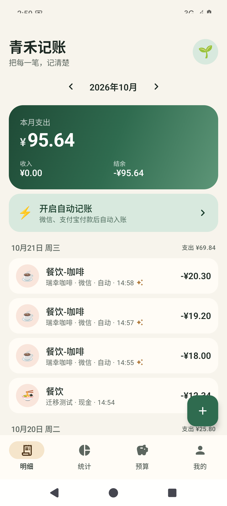
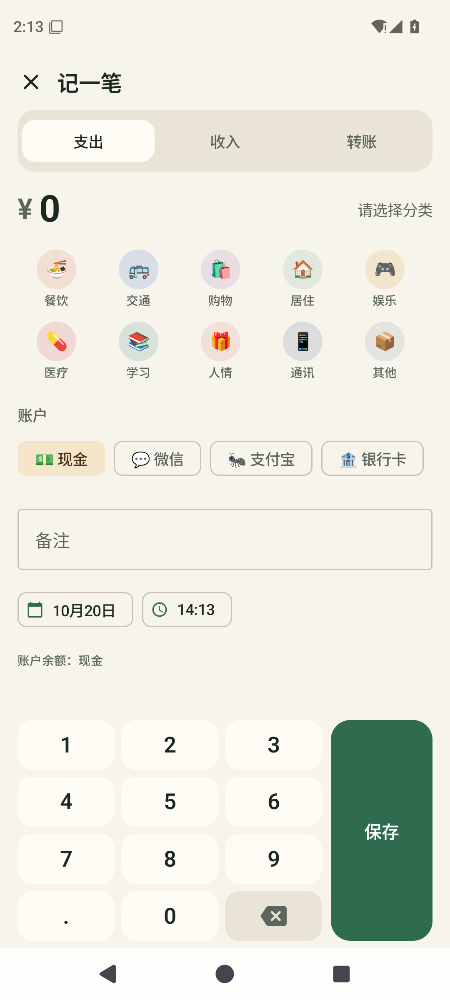
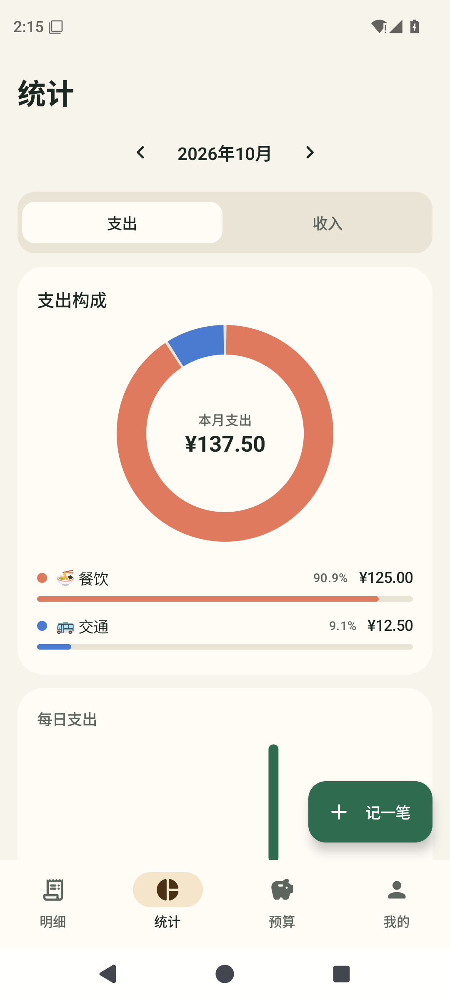
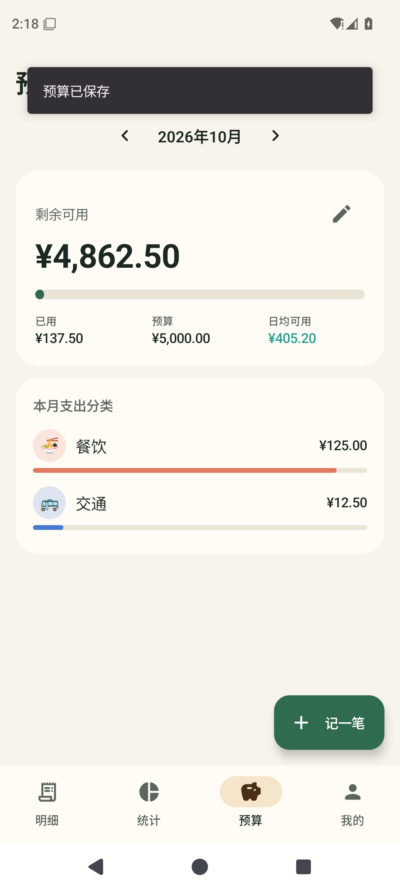
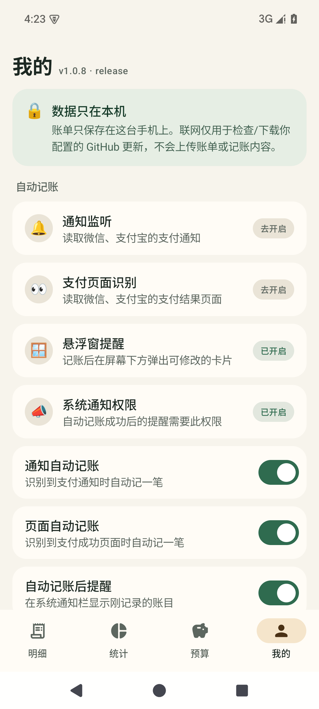
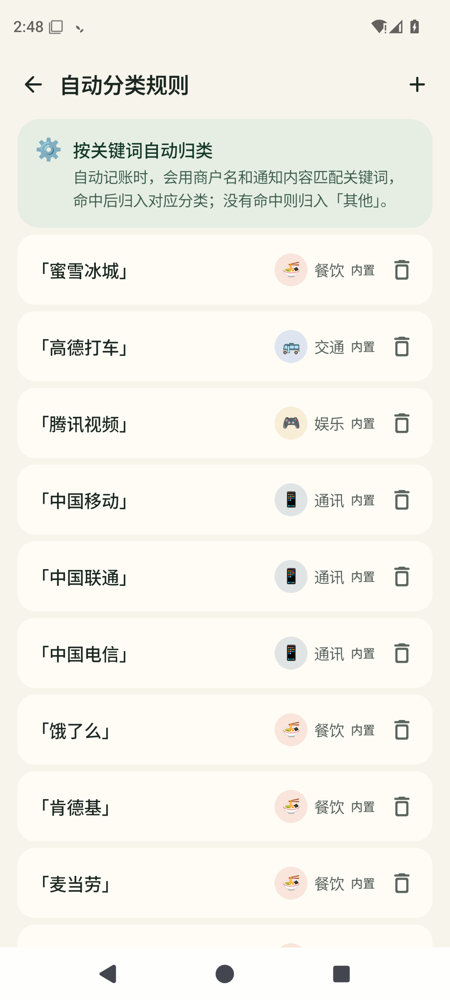

# 青禾记账

一个 Android 本地记账 App，支持微信 / 支付宝支付后的**自动记账**。功能参考一木记账的核心体验，代码与界面均为原创实现，未使用任何第三方 App 的私有代码或素材。

- 包名：`com.qinghe.ledger`
- 技术栈：Kotlin + Jetpack Compose + Room + DataStore
- 最低系统：Android 8.0（API 26）
- 目标系统：Android 15（API 35）
- 联网权限：仅用于**内置或你自定义的 GitHub 更新检查与 APK 下载**，不上传账单或记账内容。所有账目仍只保存在本机 SQLite 中。

## 界面预览

| 明细 | 记一笔 | 统计 |
| --- | --- | --- |
|  |  |  |

| 预算 | 我的 | 自动分类规则 |
| --- | --- | --- |
|  |  |  |

更多截图见 `docs/screenshots/`（账户管理、分类管理、转账页面、悬浮记账卡片）。

## 当前验证状态（2026-10-26，v1.0.10）

- **release APK 约 2.7 MB**（debug 约 21 MB），最低 Android 8.0。
- 解析器单元测试 **17/17**、更新版本比较测试 **4/4**，共 **21/21 通过**。
- 已在 Android 15（API 35）模拟器上安装运行；手动记账、编辑、长按删除、转账、预算、统计均验证通过。
- v1.0.10 新增：
  - **更新下载更稳**：优先走 GitHub API 附件通道（`api.github.com` → `release-assets.githubusercontent.com`），失败时自动回退 `github.com` 原下载地址；实测本机无法直连 `github.com` 时仍可下载。
- v1.0.9 新增：
  - **内置更新源**：默认 `newbeezzc/qinghe-ledger`，装好后点「检查更新」即可，无需手填仓库；每日自动检查仍然默认开启。
  - 发布脚本升级：clean 构建、自动更新 README 版本与 SHA-256、自动 commit/push、创建带 APK 附件的 Release（不再强制依赖 `gh`）。
- v1.0.8 新增：
  - **GitHub 应用内更新**：设置更新源（`用户名/仓库名`）后，可手动检查或每天自动检查 Release；显示版本/大小/更新说明，下载后校验包名、versionCode 和签名，再调用系统安装器。
  - 已实测：真实 GitHub 公开仓库检查、APK 下载、包名不一致拒绝；版本比较单元测试 4/4。
  - 新增子类：餐饮-一卡通、交通-电动车、人情-亲属卡、学习-云服务；老用户启动后自动补入。
  - **修改自动账目分类会自动学习规则**：把自动账目从“餐饮”改为“购物-日用”并保存后，会自动生成关键词“测试商户 → 购物-日用”的分类规则（已实测）。
  - 更新弹窗的错误信息置顶，避免被长更新说明遮住。
- v1.0.7 修复与优化：
  - **恢复完整无障碍事件范围**（修复 v1.0.6 收窄事件后微信账单无法识别的问题）；
  - **首页列表改为预计算扁平列表**：标题、副标题、金额、颜色、日期分组在数据变化时一次性计算，滚动时不再做分类查找、字符串拼接和颜色解析；
  - `LazyColumn` 使用稳定 key 与 `contentType`，行组件只接收预计算字段；
  - 青禾界面在前台时暂停无障碍树扫描，避免后台扫描和列表滚动抢主线程；
  - 缓存 `DateTimeFormatter` 与分类颜色，减少重复分配；
  - 继续使用 R8 minify/shrink 的 release 构建（2.7 MB），版本标签显示 `v1.0.7 · release`；
  - 实测 release：微信账单详情页 → 悬浮卡片「餐饮-咖啡 ¥26.60」；300 条账目压力滚动无崩溃；
  - v1.0.6 的“收窄事件”方案已回滚，避免再次影响识别。
- v1.0.5 验证：
  - **数据库升级**：从 v1.0.4（DB v1）安装到 v1.0.5（DB v2），旧账目保留，16 个大类自动补出 47 个小类；
  - **两级分类**：自动记账“瑞幸咖啡”归入「餐饮-咖啡」，明细标题显示大类-小类，备注移到副标题；
  - **悬浮弹窗**：支付后屏幕底部弹出卡片，显示金额、分类、账户、时间和备注；点「修改」可直接打开该笔账的编辑页，小类「咖啡」保持选中；
  - **诊断**：显示“最近成功识别 / 扫描次数 / 关键词搜索”，并在进程重启后仍显示“最近自动记账（已入库）”；
- v1.0.4 验证：
  - 模拟微信账单详情页（含“返回 / 账单详情”等 UI 文本，没有“支付成功”）→ 自动入账 ¥25.80，备注“瑞幸咖啡”，账单时间 **2026-10-20 14:35**；
  - 无商户名称的账单页 → 自动入账 ¥12.30，备注为空（不再写入“返回 账单详情”等垃圾文本），账单时间 **2026-10-19 09:10**；
  - 通知监听（包括断开重连后的活跃通知补扫）→ 自动入账 ¥18.00，备注“瑞幸咖啡”，账单时间取通知 **postTime**；
  - **延迟渲染测试**：账单文字延迟 1.5 秒才出现，前两次扫描失败，第 3 次重试成功入账；
  - **超大节点树测试**：1400 个节点的页面，通过 `findAccessibilityNodeInfosByText` 关键词搜索成功入账；
  - 连续快速触发 3 次页面事件，只入账 1 笔；高优先级提醒渠道可见并带震动。
- v1.0.5 新增/修复：
  - 大类-小类两级分类与 Room 1→2 迁移，自动记账按商户关键词选择小类；
  - 明细标题改为“大类-小类”，备注显示在副标题；
  - 悬浮窗自动记账卡片 +「修改」按钮，未授权时回退到通知栏；
  - 诊断新增“最近成功识别 / 扫描次数 / 关键词搜索 / 最近自动记账（已入库）”，移除“页面文本为空”提示卡；
  - 微信/支付宝版本读取（`<queries>`），可识别微信 8.0.55–8.0.58 异常；
  - 版本号显示在「我的」标题旁，并提供版本化 APK。
- v1.0.4 改进（非 OCR 多层提取）：
  - 事件类型扩展到 `typeAllMask`，并在 `onServiceConnected` 中显式设置 `FLAG_INCLUDE_NOT_IMPORTANT_VIEWS`、`FLAG_RETRIEVE_INTERACTIVE_WINDOWS`、`FLAG_REQUEST_ENHANCED_WEB_ACCESSIBILITY`；
  - 文本提取四层：DFS/事件源/多窗口遍历 → `findAccessibilityNodeInfosByText` 关键词搜索 → 父节点回溯 → 0/0.8/2/3.5 秒延迟重试；
  - 读取 `stateDescription`、`paneTitle` 等较新的无障碍字段；
  - 诊断页显示微信/支付宝版本，识别到微信 8.0.55–8.0.58 时给出已知无障碍异常提示。
- v1.0.3 改进：
  - 无障碍抓取增加 `event.source` 与节点 `refresh()`，尽量读取被部分屏蔽的页面；
  - 诊断页新增「累计微信/支付宝页面事件」「累计微信/支付宝通知」计数；
  - 页面文本为空时，诊断页提示可能的系统支付保护、微信版本异常与延迟渲染原因；
  - 诊断可区分“没有收到事件”和“收到事件但页面文本为空”。
- v1.0.2 修复：
  - 通知监听补充 MessagingStyle、历史消息、tickerText 等字段；服务连接后补扫 10 分钟内的活跃通知；诊断页显示通知监听是否连接；
  - 备注只保留商户名，提取不到商户时留空，由分类名兜底，不再塞入完整页面文本；
  - 从账单页解析「支付时间 / 付款时间 / 交易时间 / 创建时间」，通知使用系统 postTime；明细行显示具体时刻；
  - 去重同时检查“最近入库时间”和“支付时间 ±2 分钟”，避免重复补录同一笔旧账单。
- v1.0.1 修复：
  - 部分 ROM 写入无障碍组件短类名导致「支付页面识别」一直显示“去开启”；
  - 微信账单详情页缺少“支付成功”字样时无法识别；
  - 自动记账成功没有提醒（新通知渠道 + 首页权限提示 + 应用内 Snackbar）；
  - 新增「识别诊断」，可查看服务连接、最近捕获的包名/页面文本和失败原因。


## 已实现功能（MVP）

- 手动记账：支出 / 收入 / 转账，自定义金额键盘、分类、账户、日期时间、备注
- 自动记账：
  - 通知监听：解析微信「微信支付」与支付宝的支付通知，兼容 MessagingStyle、历史消息与 tickerText；连接后自动补扫活跃通知
  - 无障碍读屏：识别微信 / 支付宝的支付结果页或**单笔账单详情页**（可选，默认关闭服务授权）
  - 自动去重：90 秒内同金额不重复入账，同时按“支付时间 ±2 分钟”防止重复补录旧账单
  - 自动账目的备注只保留商户名；提取不到商户时留空，由分类名兜底
  - 账单时间优先使用页面上的「支付时间 / 交易时间」，通知使用系统 postTime；明细行显示具体时刻
  - 关键词规则自动归类（餐饮、交通、购物等 50+ 内置规则）
  - 自动记账后优先弹出屏幕下方的悬浮卡片，可直接点「修改」；未授权悬浮窗时回退到高优先级通知栏
  - **修改自动账目分类时自动学习规则**：下次遇到同一商户/备注会直接归入新分类
  - GitHub Release 应用内更新：手动或每日自动检查，下载后校验包名、版本和签名再安装
  - 「识别诊断」：查看通知监听/无障碍连接、最近成功识别、扫描次数、关键词搜索与最近自动记账
- 账户：现金、微信、支付宝、银行卡，可自定义；余额随账目自动计算
- 分类：16 个内置大类 + **51 个内置小类**（含一卡通、电动车、亲属卡、云服务），可增删自定义分类，支持 emoji 图标与“大类-小类”两级选择
- 明细：按月查看、按日分组、编辑、长按删除
- 统计：支出 / 收入构成环形图、分类占比、每日柱状图
- 预算：设置每月总预算，显示剩余、日均可用、分类花费进度
- 深色模式、下拉列表、权限状态自动刷新

## 直接安装

构建产物（推荐使用版本化文件）：

```
dist/qinghe-1.0.10.apk
```

也可以使用：

```
app/build/outputs/apk/debug/app-debug.apk
```

把 APK 传到 Android 手机上安装（需允许「安装未知来源应用」）。也可以连接手机后执行：

```bash
adb install -r dist/qinghe-1.0.10.apk
```

当前 APK 的 SHA-256：

```
e0341e0ae3ac281d891dbac6394dc1fb657354edd53cd1e1805fb20177a1c9e9
```

安装后在「我的」标题旁可以看到 `v1.0.10 · release`（如果是 `debug`，说明装错了包），用于确认版本已更新。

> 这是 R8 优化的 release 包，但使用本机 debug keystore 签名，适合自己安装体验；正式分发请替换为自己的 release 签名。

## 应用内更新（GitHub）

v1.0.9 起**内置更新源** `newbeezzc/qinghe-ledger`，装好后不需要填任何仓库地址：

1. 打开「我的 → 检查更新」，或在更新弹窗点「下载并安装」。
2. 下载完成后自动校验包名、versionCode 与签名，再交给系统安装器。
3. 「启动时自动检查更新」默认开启（每天最多一次），有新版本会直接弹窗，点一下即可更新。

首次仍需手动安装本版本（更早的 v1.0.7 及以前没有更新模块）。

发版流程：

```bash
bash scripts/publish-github.sh            # 默认发布到 newbeezzc/qinghe-ledger
```

脚本会 clean 构建 release APK、同步 README 的版本号与 SHA-256、**自动 commit 并 push**，最后创建带 APK 附件的 GitHub Release。没有安装 `gh` 时，会依次使用 `GITHUB_TOKEN`、`GH_TOKEN` 或本地 `.github-token` 文件（已在 `.gitignore` 中，不会提交）。

想换成自己的仓库：修改 `SettingsRepository.kt` 里的 `DEFAULT_GITHUB_REPO`，或仍在「我的 → GitHub 更新源」里覆盖。

### 更新限制

- **必须使用同一签名**：更新 APK 要与手机当前安装包签名一致。请始终在同一台机器上构建，或备份 `%USERPROFILE%\.android\debug.keystore`。签名不一致会被拒绝安装。
- 更新器会校验：包名、versionCode 必须更高、非 debug 构建、签名一致。任何一个不通过都会显示错误并停止安装，不会误装其他 APK。
- 首次安装更新时需要允许青禾「安装未知应用」；应用会跳到对应系统设置。
- 仓库必须公开；GitHub 未登录 API 每小时最多 60 次，普通使用足够。
- 如果关闭了「启动时自动检查更新」，只有手动点「检查更新」时才会联网。

## 开启自动记账

安装后进入「我的」页面：

1. **通知监听** → 进入系统「通知使用权」页面，找到「青禾自动记账」并开启。
2. **支付页面识别**（可选）→ 进入系统「无障碍」页面，找到「青禾支付页面识别」并开启。
3. **悬浮窗提醒** → 进入系统「显示在其他应用上层 / 悬浮窗」页面，允许青禾显示悬浮窗。未授权时会自动回退到通知栏。
4. 确认「通知自动记账」「页面自动记账」「自动记账后提醒」三个开关处于打开状态。
5. Android 13 及以上首次启动会请求通知权限；拒绝不影响记账，只是通知栏提醒不可用。

之后用微信或支付宝付款，屏幕下方会弹出「已自动记账」卡片，显示金额、大类-小类、账户、支付时间与备注；点「修改」可直接打开这笔账的编辑页。若未授权悬浮窗，则回退到高优先级通知栏。

### 真机使用注意

- 微信「微信支付」服务号通知、支付宝通知需要允许显示；静音、折叠不影响监听。
- 小米/澎湃、OPPO/ColorOS、vivo/OriginOS 等系统建议给青禾允许自启动、关闭电池优化，避免服务被系统回收。
- 覆盖安装新版本后，部分系统会重置「通知使用权」「无障碍」「悬浮窗」授权，需要重新打开。
- 自动记账依赖通知或页面中的金额文本；红包、部分小程序支付、银行直连支付可能识别不到。

### 微信账单不识别 / 没有提醒怎么办

1. **页面识别只支持单笔账单详情页**：在微信「我 → 服务 → 钱包 → 账单」里点开某一笔交易，进入“账单详情”后再看；停留在账单列表不会逐笔记录。
2. 打开「我的 → 识别诊断」，先看两个累计计数：
   - 「累计微信/支付宝页面事件」有增长，但「页面文本」为空或“页面文本太少” → 可能是微信 8.0.55–8.0.58 的无障碍 UI 树异常、WebView 延迟渲染（当前版本已自动重试 4 次）、系统支付保护或页面使用安全窗口。先确认版本和下面的排查步骤。
   - 「累计微信/支付宝通知」一直为 0 → 通知监听没有收到微信/支付宝的任何通知。先确认微信/支付宝的系统通知权限；再让朋友发一条普通微信消息测试（普通消息也会被计数，只是识别为“不是支付类通知”）。如果普通消息也不计数，说明系统/微信没有把通知交给监听服务。
   - 通知计数在增长，但打开旧账单时「最近支付通知」为空是正常的：打开账单不会产生新通知，只有真实支付/收款时才会。
   - 看「最近页面事件」的应用是否为 `com.tencent.mm`；
   - 如果显示“标记不足 / 未找到金额”，点「复制诊断」把内容反馈出来，便于继续适配；
   - 「最近支付通知」会显示微信/支付宝通知的标题、正文和识别原因。
3. 如果记账成功但没有提醒：
   - 在「我的 → 系统通知权限」确认已开启，并进入系统通知设置确认「自动记账提醒」渠道未被静音；
   - v1.0.2 起使用新的高优先级渠道，覆盖安装后不需要手动清旧渠道；
   - 首页出现「开启自动记账提醒」横幅时，点它直接跳转通知设置。

### 账单页有事件但文本为空

可能原因，按优先级排查：

1. **微信版本 8.0.55–8.0.58 的已知无障碍异常**：这些版本会返回错乱/空的 UI 树。当前版本诊断页会显示微信版本并提示；可升级微信，或临时回退到 8.0.54 再试。部分机型可开启系统「随选朗读」恢复 UI 树，但华为通常没有该选项。
2. **WebView/列表延迟渲染或节点过深**：当前版本已增加 0/0.8/2/3.5 秒四次重试、`findAccessibilityNodeInfosByText` 关键词搜索和父节点回溯。安装最新版后重新打开同一笔账单详情页再观察。
3. **华为/荣耀「支付保护中心」深度隔离**：部分机型/版本会拦截第三方无障碍读取；可关闭微信/支付宝的深度保护后再试。不是所有设备都需要关闭（一木在部分机型上不关闭也能读）。
4. **页面使用安全窗口/自绘视图**：非 OCR 方案无法读取，只能依赖通知监听或官方账单导入。

华为/荣耀关闭支付保护的路径（可选排查）：
- 桌面下拉搜索「支付保护中心」→ 右上角设置 → 深度隔离/深度保护 → 关闭微信、支付宝。
- 或 设置 → 安全 → 支付保护中心 → 关闭对应应用的保护。
- 或在设置中搜索「支付保护 / 安全支付 / 支付保险箱」。
- 关闭后重新打开微信「账单详情」页，再回「识别诊断」查看页面文本。

### 非 OCR 提取实现参考

本项目的 v1.0.4 起参考了公开项目常见的非 OCR 提取层次：

- DFS 遍历事件源、当前窗口与所有交互窗口；
- `findAccessibilityNodeInfosByText` 关键词搜索 + 父节点回溯；
- 延迟重试（0/0.8/2/3.5 秒）；
- `FLAG_INCLUDE_NOT_IMPORTANT_VIEWS`、`FLAG_RETRIEVE_INTERACTIVE_WINDOWS`、`FLAG_REQUEST_ENHANCED_WEB_ACCESSIBILITY`；
- 全事件类型监听与去抖；
- 通知监听作为独立兜底。

公开参考：
- 一木记账自动记账说明：<https://www.yimuapp.com/doc/bill/auto.html>
- BillRecord 五层文本提取（含 OCR 兜底，本项目不采用 OCR）：<https://www.yuanjisong.com/conproduction/242626>
- AutoAccounting（Xposed/Shizuku/OCR 多模式）：<https://github.com/AutoAccountingOrg/AutoAccounting>
- AutoLedge（通知 + 无障碍）：<https://github.com/doublefishes48/-AutoLedge->
- 微信 8.0.55+ UI 树异常讨论：<https://www.yuque.com/shigeyudian/xa82bq/efl04gqph6nhs964>
- 小星记账微信版本公告：<https://txc.qq.com/embed/phone/652486/profile/5/>
- 华为支付类应用被拦截说明：<https://consumer.huawei.com/cn/support/content/zh-cn00406521/>

### 识别范围与边界

- 微信：标题或内容包含「微信支付 / 微信支付凭证 / 交易单号 / 服务通知」的支付通知。
- 支付宝：标题或内容包含「支付宝 / 支付助手 / 交易单号 / 交易提醒 / 支付提醒 / 服务提醒」的支付通知。
- 通知内容必须同时出现支付类动词（支付成功、付款、扣款、收款到账、退款等）和明确金额（`¥12.34`、`12.34元` 或账单详情中的独立金额）。
- 月度账单、还款提醒、额度提醒等会被主动排除。
- 无障碍读屏要求页面同时出现至少两个支付详情标记（交易单号、账单详情、付款方式、当前状态等），避免把聊天内容误判为账单。
- 自动账目的时间优先取页面上的「支付时间 / 付款时间 / 交易时间 / 创建时间」；通知记录使用系统通知的 postTime；都取不到时才使用当前时间。
- 自动账目的备注只写入提取到的商户名；提取不到商户时备注留空，由分类名兜底，不会把“返回 / 账单详情”等页面 UI 文本写进备注。
- 自动识别不保证 100% 准确。部分银行 App、云闪付、小程序内支付可能无法识别；以微信/支付宝账单为准时建议定期核对。

## 隐私

- `INTERNET` 权限只用于检查/下载 GitHub Release 更新；不会上传账目、通知或页面文本。关闭自动检查后，只有手动点「检查更新」才会联网。
- 通知监听只读取通知标题与正文，不删除、不修改通知；无障碍服务只遍历微信 / 支付宝的窗口文本。
- 解析全部在设备本地完成，规则和账目均存入应用私有数据库。
- 关闭对应开关或撤销系统授权后，自动记账立即停止。

## 从源码构建

环境要求：JDK 17、Android SDK Platform 35、Build-Tools 35.0.0。

本机已配置：

- SDK：`D:\Software\android-sdk`
- Gradle 缓存：`D:\Software\gradle-home`
- `local.properties` 已指向本机 SDK

构建命令（Git Bash）：

```bash
export GRADLE_USER_HOME="D:/Software/gradle-home"
export ANDROID_HOME="D:/Software/android-sdk"
./gradlew.bat :app:assembleDebug :app:testDebugUnitTest
./gradlew.bat :app:assembleRelease
```

release 包输出在 `app/build/outputs/apk/release/app-release.apk`；也可以运行
`bash scripts/publish-github.sh`（可省略仓库参数）clean 构建、自动 commit/push，并发布到 GitHub Release。

如果使用 Android Studio，直接打开项目根目录即可。项目路径含中文，`gradle.properties` 中已设置 `android.overridePathCheck=true`。

## 项目结构

```
app/src/main/java/com/qinghe/ledger/
├── MainActivity.kt              # 入口
├── QingheApp.kt                 # Application / 依赖容器 / 初始化
├── di/AppContainer.kt
├── data/
│   ├── LedgerRepository.kt      # 账目、账户、分类、预算、规则
│   ├── SettingsRepository.kt    # DataStore 自动记账开关
│   ├── local/                   # Room 实体、DAO、数据库
│   └── model/Models.kt          # 收支 / 来源 / 账户类型
├── auto/
│   ├── PaymentParser.kt         # 纯 Kotlin 通知/页面解析（有单元测试）
│   ├── AutoRecorder.kt          # 去重、归类、落库
│   ├── AutoRecordNotifier.kt    # 自动记账提醒
│   ├── PaymentNotificationListener.kt
│   └── PaymentAccessibilityService.kt
├── ui/
│   ├── LedgerRoot.kt            # 底部导航与页面切换
│   ├── LedgerViewModel.kt
│   ├── components/Common.kt
│   ├── screens/                 # 明细 / 统计 / 预算 / 我的 / 记一笔 / 管理页
│   └── theme/Theme.kt
└── util/                        # 金额、日期、权限工具
```

## 测试

解析器单元测试位于：

```
app/src/test/java/com/qinghe/ledger/auto/PaymentParserTest.kt
```

覆盖微信/支付宝通知、到账、聊天误判、月账单排除、支付结果页、金额千分位等场景。

运行：

```bash
./gradlew.bat :app:testDebugUnitTest
```

> Windows 中文路径注意：Gradle 的测试 JVM 在中文路径下可能报
> `ClassNotFoundException`（类已编译但测试进程读不到类路径）。此时临时映射一个
> ASCII 盘符再运行即可：
>
> ```bash
> subst X: "D:\study\博士\杂项\记账软件开发"
> ./gradlew.bat -p X:\ :app:testDebugUnitTest
> subst X: /D
> ```
>
> 当前版本 17 个解析器用例 + 4 个更新版本比较用例，共 21 个测试全部通过。

## 已知限制 / 后续计划

- 当前只解析微信与支付宝，尚未覆盖银行 App、云闪付、短信。
- 自动记账直接入账，没有「待确认」收件箱；可在明细中编辑或删除。
- 暂无账单 CSV 导入、多账本、周期记账、报销、资产负债、iCloud/云同步。
- 上架应用商店前需要补充隐私政策、权限使用说明、应用备案等合规材料；Google Play 对通知监听与无障碍权限有严格审核，国内商店对无障碍权限也会重点审查。
- 正式发布时请用自己的签名配置 `release`，并开启 R8 / 资源压缩。

## 与一木记账的关系

本项目的产品形态参考了一木记账的自动记账、分类、统计、预算思路，但：

- 不包含一木记账的代码、图标、字体、文案或其它受版权保护的资源；
- 界面与实现均为独立编写；
- 「青禾记账」为临时名称，正式发布前请做商标检索。

如目标是「完全复刻一木记账」，建议按功能清单继续迭代，而不是复制其安装包或反编译资源。
